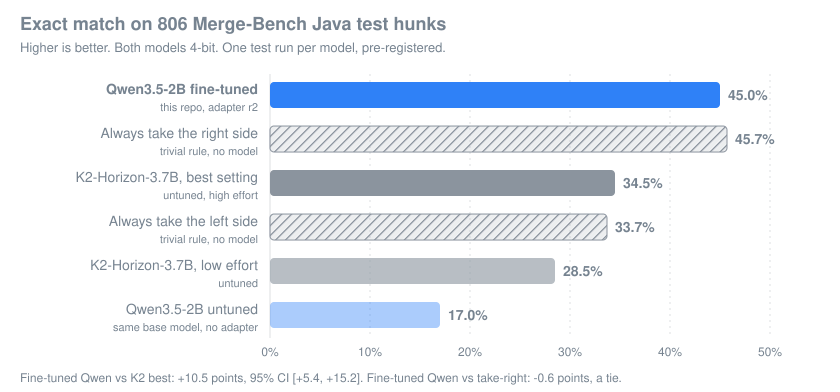
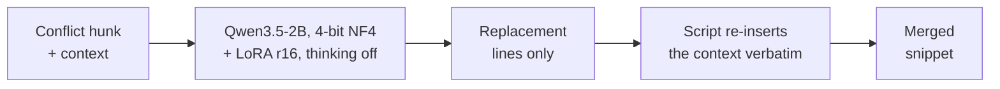

<div align="center">

# resolver

### A fine-tuned 2B model that beats a 3.7B one at Java merge conflicts


</div>

**Fine-tune Qwen3.5-2B on about 2.4k conflict hunks, on a free Kaggle T4, and it beats untuned K2-Horizon-3.7B by +10.5 points on Merge-Bench Java, with a pre-registered test and a ~1.94 GB steady-state footprint.**



## tl;dr

- 🏆 **45.0% vs 34.5% exact match** on all 806 Merge-Bench Java test hunks. That is **+10.5 points**, 95% CI **[+5.4, +15.2]**, McNemar **p < 0.0001**.
- 🪶 **Small.** A 2B base in 4-bit plus a 60 MB LoRA adapter: 1.85 GB of weights, **1.93-1.94 GB peak at steady state**.
- ⚡ **Cheap.** One epoch of QLoRA on 2,409 hunks. The winning run trained in 26 minutes.
- 🔬 **Honest.** The verdict rule was committed before the test set was touched, each model got one test run, and we graded ourselves **NEAR-WIN**, not win.
- 🤯 **Plot twist.** The one-line rule "always take the right side" scores **45.7%** on this test set. It changes how you should read every score on it.

## Honest fine print

Short, up front, and part of the result. Full detail in [`results/level4.md`](results/level4.md).

| | |
|---|---|
| **NEAR-WIN, not WIN** | The accuracy leg is a clear win. The memory leg missed on one measurement: the cold first call on a Kaggle T4 peaks at **2.17 GB** (8.5% over the 2 GB target). Steady state is 1.93-1.94 GB. |
| **Fine-tuned vs untuned** | Our model was trained on this task. K2 and untuned Qwen were not. |
| **Part of the gap is output format** | Our model writes only the replacement lines; K2 must copy about 40 context lines verbatim. On the 721 marker-free hunks the gap is still **+8.2 [+2.6, +13.4]**. Scoring K2 on its resolution region only gives +1.9 to +8.3 depending on the heuristic. K2 was never run in the resolution-only format. |
| **It ties the trivial rule** | Take-right scores 45.7%, ours 45.0%: **-0.6 points, CI [-17.8, +17.6]**. A tie. K2 does not beat it either. |
| **Scope** | Java only, 44 repositories, one seed, one run. Other languages and repositories are untested. |
| **Research artifact** | Not a production merge tool. |

## Results

Exact match with the developer's resolution, n = 806 hunks in 196 merge clusters.

| Row | Exact | + normalised |
|---|---|---|
| **Qwen3.5-2B fine-tuned (this repo)** | **45.0%** | 53.2% |
| Trivial rule: always take the right side | 45.7% | 53.0% |
| K2-Horizon-3.7B untuned, best setting (high effort) | 34.5% | 46.3% |
| Trivial rule: always take the left side | 33.7% | 42.2% |
| K2-Horizon-3.7B untuned, low effort | 28.5% | 39.8% |
| Qwen3.5-2B untuned | 17.0% | 23.2% |

| Paired comparison | Difference | 95% CI |
|---|---|---|
| **Fine-tuned Qwen vs K2 best** | **+10.5 pts** | **[+5.4, +15.2]**, p < 0.0001 |
| Fine-tuned Qwen vs K2 low effort | +16.5 | [+11.4, +20.8] |
| Fine-tuned Qwen vs untuned Qwen | +28.0 | [+23.1, +32.3] |
| Fine-tuned Qwen vs take-right | -0.6 | [-17.8, +17.6], p = 0.84 (tie) |

CIs are bootstrap intervals that resample merge commits, not hunks. K2's row is its best of 6 settings, read as generously as possible.

**Where the edge comes from:** fine-tuning turns a model that scores 17.0% into one that always answers with a code block (0 missing, vs 9 for K2) and never has to copy context. On left-only hunks it scores 58.1% against K2's 36.0%. Truly novel resolutions stay hard for everyone: 8.0% vs 5.8% on 137 hunks.

## Try it in 60 seconds

```bash
git clone https://github.com/kiranscript/resolver && cd resolver
uv venv .venv && source .venv/bin/activate
uv pip install -r requirements.txt     # pins peft and flash-linear-attention too
```

**Check our numbers. No data, no GPU, standard library only:**

```bash
python scripts/verify_from_csv.py
```

It re-derives the headline table, the CIs and the McNemar tests from [`results/level4_per_hunk.csv`](results/level4_per_hunk.csv).

**Resolve a conflict.** Needs a CUDA GPU with about 2 GB free:

```bash
python scripts/run_one.py --adapter kaggle/adapter_ds                    # built-in example
python scripts/run_one.py --adapter kaggle/adapter_ds --file my_conflict.txt
```

The built-in example is [`examples/conflict.java.txt`](examples/conflict.java.txt): a Java snippet with one conflict block and some context. The script prints the model's replacement lines, then the merged snippet.

> **Adapter status:** the Hugging Face upload is pending. Until then `kaggle/adapter_ds` is a local path (60 MB, not in git). `--adapter` accepts a local directory or a Hugging Face repo id, so nothing changes once it is published. See [`RELEASE.md`](RELEASE.md).

## How it works



**Three ideas do the work:**

1. **Resolution-only output.** The model writes just the lines that replace the conflict block. A script puts the surrounding context back, byte for byte. Outputs are short (median 29 tokens vs 116 for rewriting the whole snippet) and the model cannot corrupt code it never had to copy.
2. **QLoRA on a 4-bit base.** Rank 16, alpha 32, lr 2e-4, one epoch, greedy decoding, thinking off. Small enough to train on a free GPU and run on a 4 GB laptop one.
3. **No free lunch from the benchmark's bias.** Every training hunk gets a random side orientation, so the model cannot learn "the right side usually wins". That costs points on this right-leaning test set and we did it anyway, because a model that memorises orientation would not generalise.

Training data is 2,431 cleaned Java hunks (2,409 representable in the resolution format), grouped by merge commit and package root, with zero overlap with the test set.

## The five levels

The project ran breadth-first with a gate at every level: no level started until the one before passed. Plan: [`alpha.md`](alpha.md).

| Level | Question | Outcome |
|---|---|---|
| [0](results/level0.md) | Is the benchmark sound? | Scorer verified against Merge-Bench on 12,090 cases with 0 mismatches. Take-right floor discovered: 45.7%. |
| [1](results/level1.md) | Do both models run, and what is the gap? | Both load at 4-bit. K2's best setting found on a 200-hunk sample: high effort plus a no-decline prompt. |
| [2](results/level2.md) | Is the training data clean? | 2,431 train / 304 dev hunks, grouped by merge SHA and package root, zero overlap with test. |
| [3](results/level3.md) | Does a small fine-tune work? | 4 QLoRA runs, all above the dev trivial floor. Winner: r2, the resolution format. |
| [4](results/level4.md) | The verdict | **NEAR-WIN**, against a rule [pre-registered](results/level4_preregistration.md) before any test run. |

Every level was reviewed by Claude Fable 5.2 before its commit.

## Memory

Batch size 1, longest test prompt (527 tokens), PyTorch peak allocated, GB = 1e9 bytes.

| Measurement | GB |
|---|---|
| 4-bit weights, text-only | 1.79 |
| + LoRA adapter | 1.85 |
| **Steady-state generation peak** (RTX 3050 and Kaggle T4) | **1.93-1.94** |
| Cold first call in a fresh process, Kaggle T4 | 2.17 |
| Whole process incl. CUDA context (`nvidia-smi`) | 2.09 local, 2.66 Kaggle |

About 1.02 GB of the weights is the tied fp16 embedding table, so the path below 2 GB everywhere is a smaller vocabulary. See [What's next](#whats-next).

## Reproduce everything

```bash
uv venv .venv && uv pip install -r requirements.txt
scripts/fetch_data.sh                 # clones pinned Merge-Bench repos, downloads and checksums the data
python scripts/prepare_data.py        # Level 0: scorer checks and trivial floors
python scripts/build_level2.py        # Level 2: cleaned train set, merge-grouped dev set
python kaggle/level1/build.py highb   # builds a Level 1 Kaggle kernel (modes: smoke2, fast, higha, highb); does not push
python kaggle/level3/build.py <mode>  # builds a Level 3 Kaggle kernel (modes in kaggle/level3/grids.json); does not push
python scripts/level1_report.py
python scripts/level3_report.py
python scripts/level4_report.py       # writes results/level4.json and results/level4_per_hunk.csv
```

Good to know:

- The Kaggle kernels read the data and the r2 adapter from private Kaggle datasets (`resolver-data`, `resolver-adapter`). You will need your own copies.
- Raw generations stay local and gitignored because they contain third-party code. Per-hunk outcomes are public in [`results/level4_per_hunk.csv`](results/level4_per_hunk.csv).
- The hunk data is not redistributed. `scripts/fetch_data.sh` rebuilds it from pinned SHAs and a sha256.

## What's next

The plan says a win or near-win means **scale up**:

- ✂️ **Vocabulary trimming.** An ASCII-only vocabulary would save about 0.49 GB, putting the steady peak near 1.45 GB and the T4 first call near 1.7 GB.
- 📈 **More data and seeds.** More Java hunks via Merge-Bench-Builder, 2-3 epochs, several seeds.
- 🌍 **Other languages.** Merge-Bench covers 11; we have tested one.
- ⚖️ **K2 in the resolution-only format.** The fairest rematch, and the one experiment that would pin down how much of the gap is format.

## License and attribution

- **Code:** MIT, see [`LICENSE`](LICENSE).
- **Adapter:** Apache-2.0, inherited from the base model `Qwen/Qwen3.5-2B`. Model card draft: [`release/MODEL_CARD.md`](release/MODEL_CARD.md).
- **K2-Horizon-3.7B:** Apache-2.0 per its model card. Used only as a baseline, not redistributed.
- **Data:** Merge-Bench hunks are excerpts of third-party repositories under their own licenses. They are not redistributed here.

Release status and open items: [`RELEASE.md`](RELEASE.md).

## Credits

- **Merge-Bench** by Schesch and Ernst: the benchmark, the builder and the scoring rule this work stands on.
- **Qwen Team** for Qwen3.5-2B.
- **IFM** for K2-Horizon-3.7B, a strong baseline that made this worth doing.
- Level-by-level reviews by **Claude Fable 5.2**.
